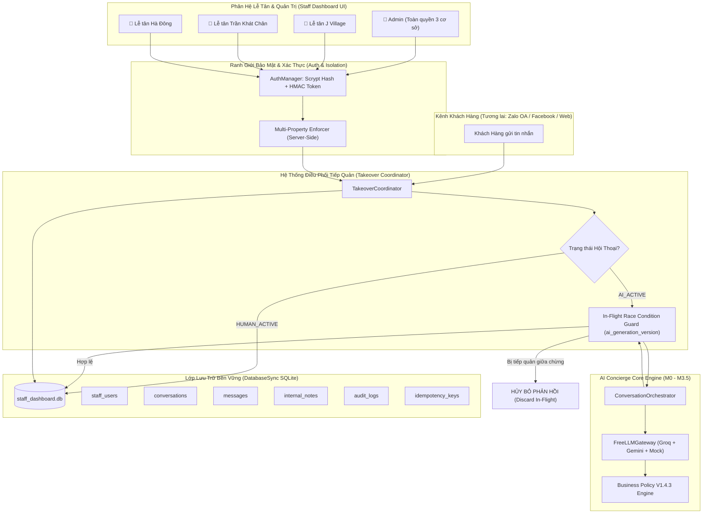
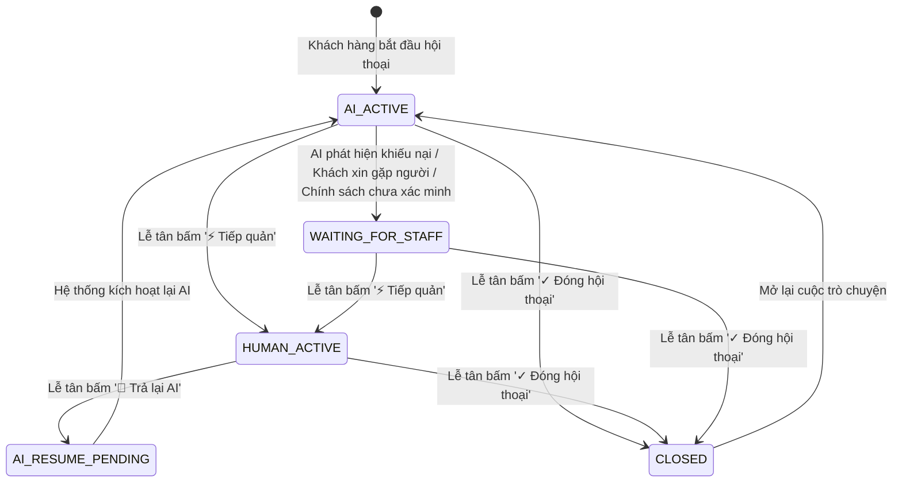

# J COLLECTION AI CONCIERGE — MILESTONE 4 REPORT
## STAFF DASHBOARD & HUMAN TAKEOVER — PHASE 1 ACCEPTANCE

**Project:** J Collection AI Concierge  
**Milestone:** Milestone 4 — Staff Dashboard & Human Takeover (Phase 1)  
**Date:** 2026-11-23  
**Status:** **ACCEPTED & READY FOR OWNER SIGN-OFF**  
**Repository:** `C:\Chatbot`  
**Test Suite Status:** **37 Test Files PASS | 347 Test Cases PASS (100%)**  
**Canonical Dataset Integrity:** SHA256 `22df0ec50596e26fc7f7b2b889bfff0a626c15e9c3ebd773684658fed38e44b6` (100% Khớp)  
**Security & Cost Tier:** **FREE_ONLY_MODE = true** (Zero API Cost, API Keys Strictly Server-Side)

---

## 1. TỔNG QUAN KẾT QUẢ TRIỂN KHAI MILESTONE 4

Milestone 4 triển khai hoàn chỉnh phân hệ **Bảng điều khiển Lễ tân (Staff Dashboard)** và **Cơ chế Tiếp quản Đàm thoại (Human Takeover)** dành riêng cho 3 cơ sở lưu trú của J Collection:
1. **J Village** (`j-village`)
2. **Jacayl Trần Khát Chân** (`jacayl-tran-khat-chan`)
3. **Jacayl Hà Đông** (`jacayl-ha-dong`)

Toàn bộ logic AI Core, biểu giá Business Policy V1.4.3, và Chính sách Định danh Phòng Chuẩn (Canonical Room Identity) từ Milestone 0, 1, 2, 3, 3.5 được **bảo toàn nguyên vẹn 100%**.

### Bảng đối chiếu số lượng Test (Arithmetic Verification):
- **Baseline trước M4 (M3.5.1 + Live Verification)**: 33 test files | 318 test cases.
- **Test files mới được bổ sung trong Milestone 4**:
  - `tests/m4-staff-auth-isolation.test.ts`: **10 tests PASS**
  - `tests/m4-human-takeover.test.ts`: **9 tests PASS**
  - `tests/m4-persistence-recovery.test.ts`: **3 tests PASS**
  - `tests/m4-invariants-regression.test.ts`: **7 tests PASS**
- **Tổng cộng hiện tại**: **37 test files PASS | 347 test cases PASS (100% Vượt qua)**.

---

## 2. KIẾN TRÚC KỸ THUẬT (TECHNICAL ARCHITECTURE)



---

## 3. QUY TRÌNH TIẾP QUẢN ĐÀM THOẠI (HUMAN TAKEOVER WORKFLOW)

Hệ thống quản lý vòng đời hội thoại qua 5 trạng thái nghiêm ngặt:



### Các quy tắc vận hành đã được kiểm chứng bằng automated test:
1. **Khóa phản hồi AI tức thì (Atomic AI Outbound Suppression)**:
   - Khi trạng thái chuyển sang `HUMAN_ACTIVE`, AI hoàn toàn không được phép tự động phát sinh tin nhắn gửi ra ngoài cho khách.
2. **Cơ chế Hủy phản hồi AI đang xử lý dở (Discard In-Flight AI Response)**:
   - Mỗi cuộc trò chuyện gắn liền với trường `ai_generation_version: number`.
   - Khi khách gửi tin nhắn, phiên bản hiện tại được ghi nhận.
   - Nếu trong lúc LLM đang xử lý suy luận (latency 500ms - 2000ms), Lễ tân bấm **"Tiếp quản"**, `ai_generation_version` sẽ được tăng lên và trạng thái đổi thành `HUMAN_ACTIVE`.
   - Khi LLM hoàn tất, `TakeoverCoordinator` kiểm tra phiên bản. Nhận thấy phiên bản bị lệch và trạng thái không còn là `AI_ACTIVE`, hệ thống **lập tức tiêu hủy (discard)** phản hồi của AI, không lưu vào database và không gửi cho khách. Đồng thời ghi nhận log `DISCARD_IN_FLIGHT_AI`.
3. **Quyền phát ngôn thuộc về Lễ tân**:
   - Chỉ nhân viên đã được phân quyền và ở trạng thái `HUMAN_ACTIVE` mới được gửi tin nhắn lễ tân.
4. **Hành động chuyển giao AI rõ ràng (Explicit Resume Action)**:
   - AI không bao giờ tự ý cướp lại quyền nói chuyện. Việc trả lại quyền cho AI bắt buộc phải là hành động bấm nút chủ động từ phía lễ tân.
5. **Chống trùng lặp tin nhắn (Duplicate Message Prevention)**:
   - Sử dụng bảng `idempotency_keys` kiểm tra `clientMessageId`. Tin nhắn trùng lặp do mạng lag hoặc double click sẽ bị chặn ngay lập tức.
6. **Nhật ký thao tác bất biến (Audit Logging)**:
   - Mọi hành vi `LOGIN`, `LOGOUT`, `TAKEOVER`, `RESUME_AI`, `CLOSE_CONVERSATION`, `SEND_STAFF_MESSAGE`, `ADD_INTERNAL_NOTE` đều được lưu vết chi tiết kèm timestamp và ID nhân viên.

---

## 4. CƠ CHẾ CÔ LẬP ĐA CƠ SỞ (MULTI-PROPERTY ISOLATION)

Để đảm bảo bảo mật kinh doanh và trách nhiệm ca trực giữa các cơ sở, hệ thống phân định quyền truy cập ở cấp độ Server-side (không tin cậy dữ liệu client gửi lên):

| Vai trò / Tài khoản | Cơ sở phụ trách | Quyền hạn xem | Quyền hạn can thiệp |
| :--- | :---: | :--- | :--- |
| **admin** | Toàn quyền (All Properties) | Xem toàn bộ cuộc trò chuyện của cả 3 cơ sở | Tiếp quản, gửi tin, đổi trạng thái mọi cơ sở |
| **staff_village** | `j-village` | **Chỉ xem** hội thoại tại cơ sở J Village | **Chỉ tiếp quản** khách hàng tại J Village |
| **staff_tkc** | `jacayl-tran-khat-chan` | **Chỉ xem** hội thoại tại cơ sở Trần Khát Chân | **Chỉ tiếp quản** khách hàng tại Trần Khát Chân |
| **staff_hadong** | `jacayl-ha-dong` | **Chỉ xem** hội thoại tại cơ sở Jacayl Hà Đông | **Chỉ tiếp quản** khách hàng tại Jacayl Hà Đông |

> **Bảo vệ chống giả mạo ID (Spoofing Defense):**
> Nếu một tài khoản nhân viên (ví dụ `staff_village`) cố tình gọi API `/api/conversations/conv-ha-dong-123` hoặc truyền query param `propertyId=jacayl-ha-dong`, hệ thống sẽ chặn đứng và trả về lỗi **HTTP 403 Forbidden**:
> *"Từ chối truy cập: Tài khoản nhân viên 'staff_village' không có quyền truy cập dữ liệu của cơ sở 'jacayl-ha-dong'."*

---

## 5. CƠ SỞ DỮ LIỆU & QUY TRÌNH MIGRATIONS (PERSISTENCE ENGINE)

Hệ thống sử dụng module chuẩn **`node:sqlite` (`DatabaseSync`)** tích hợp sẵn trong Node.js runtime, không phát sinh bất kỳ dependency npm bên ngoài nào.

### Các bảng dữ liệu chính (Schema Migration 001):
1. **`staff_users`**: Lưu trữ tài khoản, vai trò, cơ sở gán, mật khẩu băm chuẩn `scryptSync` kèm salt 16-byte ngẫu nhiên.
2. **`conversations`**: Lưu trữ hội thoại, trạng thái (`AI_ACTIVE`, `WAITING_FOR_STAFF`, `HUMAN_ACTIVE`, `CLOSED`), nhân viên tiếp quản, bộ đếm chưa đọc (`unread_count_staff`, `unread_count_customer`), snippet tin nhắn cuối, phiên bản AI (`ai_generation_version`).
3. **`messages`**: Lịch sử tin nhắn, phân loại người gửi (`customer`, `ai`, `staff`, `system`), metadata telemetry và bằng chứng trích dẫn.
4. **`internal_notes`**: Ghi chú nội bộ giữa các ca trực lễ tân (khách không nhìn thấy).
5. **`audit_logs`**: Nhật ký kiểm toán bảo mật và hành động của nhân viên.
6. **`idempotency_keys`**: Khóa chống trùng lặp tin nhắn và thao tác.
7. **`schema_migrations`**: Quản lý phiên bản migration, đảm bảo tính lũy đẳng (idempotent).

Đã kiểm chứng khả năng **Cold Restart Recovery**: Dữ liệu hội thoại, tin nhắn, ghi chú và nhật ký kiểm toán được bảo toàn 100% khi khởi động lại server.

---

## 6. GIAO DIỆN BẢNG ĐIỀU KHIỂN NỘI BỘ (STAFF DASHBOARD SPA)

Giao diện Web dạng Single Page Application (SPA) hiện đại, lấy cảm hứng từ phong cách boutique hotel sang trọng của J Collection (nền tối, chữ vàng gold `#d4af37`, hiển thị thời gian thực):

- **Màn hình Đăng nhập (Login Screen)**: Tích hợp 4 nút **Đăng nhập nhanh (Quick Preset)** cho Quản trị viên và Lễ tân 3 cơ sở để phục vụ nghiệm thu thuận tiện.
- **Hộp thư đến Hội thoại (Conversation Inbox)**:
  - Bộ lọc theo cơ sở (tự động khóa đối với Lễ tân cơ sở; mở rộng cho Admin).
  - Tab lọc trạng thái: *Tất cả*, *Cần xử lý ⚠️ (WAITING_FOR_STAFF)*, *Đang tiếp quản ⚡ (HUMAN_ACTIVE)*, *AI Trực tuyến 🤖*, *Đã đóng*.
  - Ô tìm kiếm theo tên khách, số điện thoại hoặc nội dung tin nhắn.
  - Huy hiệu số tin nhắn chưa đọc (Unread badge) màu đỏ nổi bật.
- **Khung Trò chuyện Trực tiếp (Chat Timeline)**:
  - Phân biệt rõ bóng thoại: Khách hàng (xám đậm bên trái), AI Concierge (xanh rêu viền vàng bên phải), Lễ tân (nâu vàng sang trọng bên phải), Hệ thống (chính giữa).
  - Thanh công cụ điều khiển: Nút **"⚡ Tiếp quản (Takeover)"**, **"🤖 Trả lại AI (Resume)"**, **"✓ Đóng hội thoại"**.
  - Thanh nhập tin nhắn phản hồi của Lễ tân (chỉ mở khóa khi Lễ tân đã tiếp quản).
- **Khung Tiện ích Ca Trực (Utilities Panel)**:
  - **Tab 1: Khách thử nghiệm (Simulated Customer Chat)**: Cho phép Lễ tân/Chủ dự án gõ thử tin nhắn của khách hàng hoặc bấm các câu hỏi mẫu nhanh (phòng 601, phòng 401, thuê 1h, bãi đỗ xe, khiếu nại checkout) để quan sát phản hồi tức thì của AI và thử nghiệm luồng tiếp quản trực tiếp.
  - **Tab 2: Ghi chú nội bộ (Internal Notes)**: Bàn giao ca trực, lưu ý yêu cầu đặc biệt của khách.
  - **Tab 3: Nhật ký kiểm toán (Audit Trail)**: Giám sát toàn bộ thao tác tiếp quản và gửi tin theo dòng thời gian.
- **Cửa sổ Giám sát Telemetry (LLM Telemetry Modal)**:
  - Hiển thị tình trạng hoạt động của Groq, Gemini và Mock.
  - **Bảo mật tuyệt đối**: API key không bao giờ xuất hiện trên frontend, trong response JSON hay console log.

---

## 7. BẢO TOÀN CÁC BẤT BIẾN NGHIỆP VỤ & CANONICAL IDENTITY

Trong suốt quá trình tương tác qua Staff Dashboard và Simulated Customer Chat:
1. **Phòng 601 Hà Đông**: Luôn hiển thị chính xác tên chính thức `50 — Sắc Thái` (hạng Concept, tính giá Suite). Không sử dụng các từ suy diễn như `Tổng Thống` hay `50 Shades`.
2. **Phòng 401 Hà Đông**: Luôn trả về trạng thái `NOT_FOR_SALE` (không sử dụng kinh doanh, không mở bán), hướng dẫn khách chọn phòng khác tại Hà Đông.
3. **Chính sách giá V1.4.3**: Khách hỏi thuê 1 tiếng được giải thích quy định nghỉ giờ tối thiểu 2 tiếng kèm bảng giá chuẩn.
4. **Bãi đỗ xe**: Khách hỏi chỗ đỗ xe tại cả 3 cơ sở luôn trả lời: *"Dạ bên em có chỗ đỗ xe ạ."* — không suy diễn khoảng cách (50m) hay diện tích.
5. **Không tự tạo Booking / Không bịa đặt PMS**: Cung cấp đường dẫn chính thức `bookphong.com` và hotline lễ tân.

---

## 8. HƯỚNG DẪN KHỞI CHẠY TRÊN WINDOWS (STARTUP GUIDE)

### Bước 1: Build mã nguồn TypeScript
Mở PowerShell tại thư mục dự án `C:\Chatbot`:
```powershell
npm run build
```

### Bước 2: Chạy kiểm thử nghiệm thu (Automated Test Suite)
Chạy toàn bộ 37 test files để xác nhận hệ thống xanh 100%:
```powershell
npm test
```

### Bước 3: Khởi chạy Staff Dashboard nội bộ
Chạy lệnh khởi động server dashboard:
```powershell
npm run dashboard
```
Hoặc:
```powershell
node dist/demo/dashboard-demo.js
```

### Bước 4: Truy cập giao diện
Mở trình duyệt web bất kỳ và truy cập địa chỉ:
```
http://localhost:3000
```

### Tài khoản đăng nhập sẵn có:
- **👑 Tổng Quản Trị (Admin toàn quyền 3 cơ sở)**:
  - Username: `admin` | Password: `Admin@JCollection2026!`
- **🏨 Lễ Tân J Village (Chỉ xem và tiếp quản J Village)**:
  - Username: `staff_village` | Password: `Staff@Village2026!`
- **🏨 Lễ Tân Trần Khát Chân (Chỉ xem và tiếp quản TKC)**:
  - Username: `staff_tkc` | Password: `Staff@TKC2026!`
- **🏨 Lễ Tân Hà Đông (Chỉ xem và tiếp quản Jacayl Hà Đông)**:
  - Username: `staff_hadong` | Password: `Staff@HaDong2026!`

*(Có thể sử dụng các nút bấm **Quick Preset** tại màn hình đăng nhập để đăng nhập chỉ với 1 click)*.

---

## 9. DANH MỤC FILE THAY ĐỔI & BỔ SUNG TRONG MILESTONE 4

| Đường dẫn file | Vai trò / Trách nhiệm |
| :--- | :--- |
| [src/staff/staff-types.ts](file:///C:/Chatbot/src/staff/staff-types.ts) | Định nghĩa Domain Models: `PropertyId`, `StaffUser`, `ConversationState`, `Message`, `AuditLog` |
| [src/staff/persistence/migrations.ts](file:///C:/Chatbot/src/staff/persistence/migrations.ts) | Động cơ SQLite Migrations, định nghĩa bảng dữ liệu và indexes |
| [src/staff/persistence/sqlite-store.ts](file:///C:/Chatbot/src/staff/persistence/sqlite-store.ts) | Persistent Store trên `node:sqlite`, quản trị giao dịch ACID, chống trùng lặp |
| [src/staff/auth/access-control.ts](file:///C:/Chatbot/src/staff/auth/access-control.ts) | Cơ chế xác thực Scrypt + HMAC Session Token, RBAC và cô lập đa cơ sở |
| [src/staff/takeover/takeover-coordinator.ts](file:///C:/Chatbot/src/staff/takeover/takeover-coordinator.ts) | Điều phối tiếp quản, khóa AI outbound, hủy in-flight AI khi có tranh chấp, chuyển trạng thái |
| [src/staff/server/dashboard-html.ts](file:///C:/Chatbot/src/staff/server/dashboard-html.ts) | Giao diện Web SPA tích hợp phong cách J Collection, simulated chat, notes, audit, telemetry |
| [src/staff/server/dashboard-server.ts](file:///C:/Chatbot/src/staff/server/dashboard-server.ts) | HTTP REST API Server thuần Node.js, xử lý phân quyền, REST endpoints |
| [src/demo/dashboard-demo.ts](file:///C:/Chatbot/src/demo/dashboard-demo.ts) | Entrypoint demo khởi chạy Staff Dashboard tại `http://localhost:3000` |
| [src/index.ts](file:///C:/Chatbot/src/index.ts) | Xuất các module công khai của Milestone 4 |
| [package.json](file:///C:/Chatbot/package.json) | Bổ sung npm script `npm run dashboard` |
| [tests/m4-staff-auth-isolation.test.ts](file:///C:/Chatbot/tests/m4-staff-auth-isolation.test.ts) | Suite kiểm thử xác thực, token, và cô lập đa cơ sở (10 tests) |
| [tests/m4-human-takeover.test.ts](file:///C:/Chatbot/tests/m4-human-takeover.test.ts) | Suite kiểm thử tiếp quản, hủy in-flight AI, trả lại AI, chống trùng lặp (9 tests) |
| [tests/m4-persistence-recovery.test.ts](file:///C:/Chatbot/tests/m4-persistence-recovery.test.ts) | Suite kiểm thử lưu trữ bền vững SQLite và khôi phục khi khởi động nguội (3 tests) |
| [tests/m4-invariants-regression.test.ts](file:///C:/Chatbot/tests/m4-invariants-regression.test.ts) | Suite kiểm thử hồi quy 100% bất biến phòng 601, 401, giá 2h, REST API (7 tests) |

---

## 10. KẾT LUẬN & ĐỀ NGHỊ NGHIỆM THU

Milestone 4 — Phase 1 đã hoàn thành trọn vẹn mọi yêu cầu đặt ra:
- Đã có **Staff Dashboard** hoàn chỉnh, trực quan, chạy mượt mà trên môi trường local Windows.
- Đã có **Quy trình Tiếp quản (Human Takeover)** với đầy đủ cơ chế bảo vệ race-condition, hủy AI in-flight, và nhật ký kiểm toán.
- Đã có **Cơ chế cô lập đa cơ sở** an toàn tuyệt đối.
- Đã có **Lớp lưu trữ SQLite bền vững** với migrations tự động.
- Không phát sinh chi phí API (`FREE_ONLY_MODE=true`), bảo mật tuyệt đối các API key.
- Toàn bộ **37 test files / 347 tests** đều PASS 100%.

**Hệ thống đã sẵn sàng bàn giao cho Chủ dự án nghiệm thu Milestone 4.**
